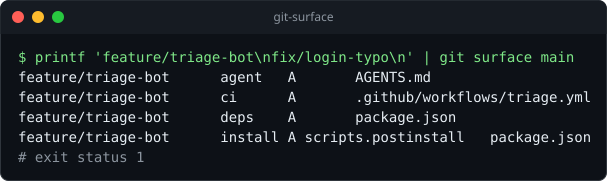
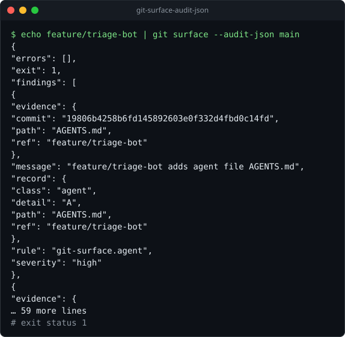

# git-surface

git-surface is one git command, `git surface`. Installing it puts `git-surface` on your `PATH`;
git runs any `git-NAME` program on `PATH` as `git NAME`, so no configuration is needed.

When many branches arrive at once, many of them written by coding agents, a reviewer needs to
know which ones change something that runs or is trusted: a CI workflow, a git hook, an install
script, a dependency, a build file, or text that hides content from a human reader. Text in an
issue or pull request can steer an agent into exactly such a change, and malicious packages
spread through install scripts and new dependencies. `git surface` lists, for each branch, every
change of that kind, so those branches get a closer look.

It only reports. It does not block, score or rewrite anything; what to do with a report is up
to whoever runs it.

## Example output

A demo repository in which one branch adds an agent instruction file, a CI workflow, a
`package.json` with a `postinstall` script, and edits `app.py`; a second branch only edits
`app.py`, so it is not reported:

<p align="center"></p>

The same branch with `--audit-json` (first lines of the result):

<p align="center"></p>

## Requirements

- Python 3.9 or later, standard library only.
- git 2.38 or later, as an executable named `git` on `PATH`.

## Install

From PyPI:

```
pip install git-surface
```

From a clone:

```
git clone https://github.com/jacob-adm/git-surface
cd git-surface
pip install .
```

Either way pip installs `git-surface` as a console script. Check the install:

```sh
git surface --version
```

```text
git-surface 0.4.0
```

Use `-h` for usage: `git surface --help` is answered by git itself, which looks for a manual
page. Without installing, it also runs from a clone as `python3 -m git_surface`.

## How it works

1. **List the branches.** Pipe the branch names in, one per line. Only the first TAB-separated
   field of each line is read, so the output of `git footprint BASE` (from git-overlap) pipes
   straight in too.
2. **Diff each branch against BASE.** For each branch, `git surface BASE` compares the branch
   with its merge base with BASE: the same changes a pull request's "files changed" shows.
   Changes BASE made after the branch left it are not the branch's.
3. **Classify each changed path.** By its name, a path may be `ci`, `hook`, `agent`, `repo`,
   `install`, `deps` or `exec`; a file that becomes executable is `exec` too. `package.json`, `pyproject.toml` and
   `requirements*.txt` are read to name added and removed dependencies, version changes and
   changed install steps.
4. **Check the added lines.** Only lines the branch adds are read. An HTML tag such as `` or
   `<script>`, or an HTML comment, on an added line of a Markdown file, or an invisible or
   bidirectional Unicode character on an added line of any text file, is `hidden`.
5. **Read the report.** One line per finding, `ref TAB class TAB detail TAB path`. Like `grep`,
   the command exits 1 when it reports something, 0 when it reports nothing and 2 on an error.

The full list of classes and rules is in [Classes](https://github.com/jacob-adm/git-surface/blob/main/docs/classes.md).

## Commands

```
git surface [-z] [--json | --audit-json] BASE < refs   report what each ref changes that runs or is trusted
```

See [Commands](https://github.com/jacob-adm/git-surface/blob/main/docs/commands.md) for the input, output, options and exit status.

## Quick start

Inside the repository to check, list the branches one per line and pipe them in. Replace `main`
with the base branch and `refs/heads/agent/` with the refs to check, for example
`refs/remotes/origin/` for every branch fetched from `origin`.

```sh
git for-each-ref --format='%(refname:short)' refs/heads/agent/ | git surface main
```

```text
agent/ci	ci	M	.github/workflows/test.yml
agent/ci	exec	A +x	scripts/release.sh
agent/deps	deps	M +left-pad	package.json
agent/deps	install	M scripts.postinstall	package.json
agent/docs	hidden	<!-- line 4	README.md
agent/docs	hidden	<img line 5	README.md
```

`agent/ci` changes a workflow and adds an executable script. `agent/deps` adds the dependency
`left-pad` and a `postinstall` script. `agent/docs` adds an HTML comment and an image tag to the
README, neither of which shows when the Markdown is rendered. A fourth branch, `agent/fix`, only
changes application code, so it has no line.

## Documentation

- [Commands](https://github.com/jacob-adm/git-surface/blob/main/docs/commands.md): input, output, options, exit status and errors.
- [Running it in CI](https://github.com/jacob-adm/git-surface/blob/main/docs/ci.md): a tested GitHub Actions workflow for pull requests, and a pre-push hook.
- [Classes](https://github.com/jacob-adm/git-surface/blob/main/docs/classes.md): every class, the paths and content each one covers, and the detail
  field.
- [Limitations and security](https://github.com/jacob-adm/git-surface/blob/main/docs/limitations-and-security.md): what the command misses, and
  what it reads and runs.
- [Using it with other tools](https://github.com/jacob-adm/git-surface/blob/main/docs/other-tools.md): tested stacks with
  git-overlap, trust-path, pr-merge-audit and release-drift.
- [Contributing](https://github.com/jacob-adm/git-surface/blob/main/CONTRIBUTING.md): running the tests and contributing a change.
- [Reporting a vulnerability](https://github.com/jacob-adm/git-surface/blob/main/SECURITY.md)

## License

Apache License 2.0; see [LICENSE](https://github.com/jacob-adm/git-surface/blob/main/LICENSE).
